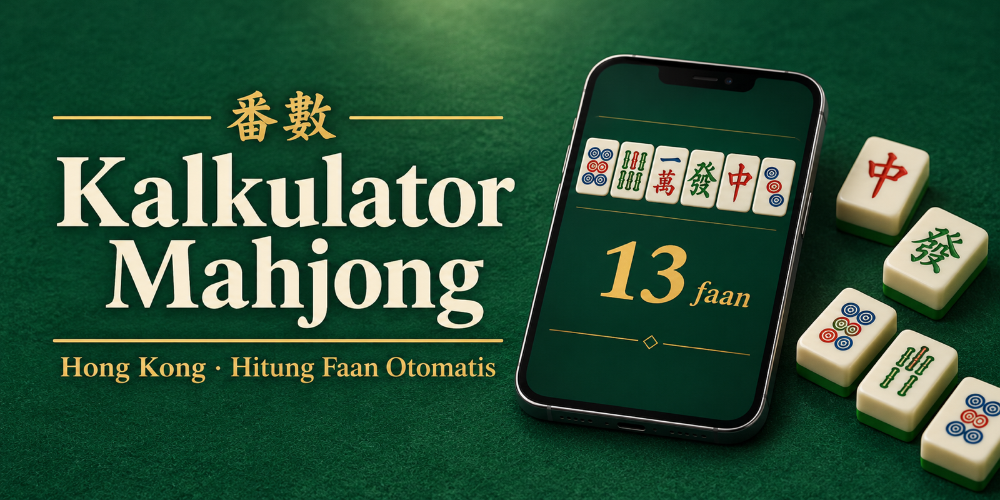

<p align="center">
  
</p>

<p align="center">
  <a href="https://arifkyi.github.io/kalkulator-mahjong"></a>
  <a href="https://www.virustotal.com/gui/file/866b4ce5a99a1cbc86a086d57a8d868c7459d0bea8308382ac9b81b448e6239b"></a>
  <a href="LICENSE"></a>
  <br>
  
  
  
  
  
</p>

# Kalkulator Mahjong Hong Kong (Kalkulator Faan 番數)

**🇮🇩 Bahasa Indonesia** | [🇬🇧 English](#english)

Kalkulator untuk menghitung poin (faan) mahjong Hong Kong secara otomatis. Susun 14 tile tangan menang, pilih kondisi menang, lalu nama hand dan total faan langsung muncul beserta rinciannya.

**Buka kalkulator:** https://arifkyi.github.io/kalkulator-mahjong

Dibuat oleh Ahmad Rifky Idrus untuk channel YouTube **Rifky The Lifestyle**.

## Fitur

- 14 slot tile: ketuk, seret, atau ganti tile dengan tombol ▲ ▼
- Mendeteksi semua pola hand: Ping Hu, All Pongs, Half Flush, Full Flush, Seven Pairs, Little/Big 3 Dragons, Little/Big 4 Winds, Mixed Orphans, dan semua limit hand
- Angin kursi, angin ronde, bunga, Zi Mo, Ron, Kong, dan kondisi menang khusus
- Opsi yang tidak mungkin terjadi otomatis dikunci (contoh: Merampok Kong hanya bisa saat Ron)
- Memberi tahu kalau tangan belum cukup faan untuk Hu, dan apakah Zi Mo bisa mencukupinya
- Nama hand dalam bahasa Indonesia/Inggris, 漢字, dan romanisasi Kanton

## Sumber aturan

Nilai faan mengikuti halaman Wikipedia [Hong Kong mahjong scoring rules](https://en.wikipedia.org/wiki/Hong_Kong_mahjong_scoring_rules): minimum 3 faan, maksimum 13 faan, dan semua kriteria dijumlahkan (stacked).

Aturan yang berbeda di tiap komunitas bisa diubah di bagian **Pengaturan aturan** (House Rule):

| Pengaturan | Wikipedia (default) | House Rule |
|---|---|---|
| Menang dari tile pengganti | +1 | +2 |
| Tertutup + Zi Mo | 1 + 1 = 2 | 3 |
| Seven Pairs dapat Tangan Tertutup | Tidak | Ya |
| Semua 8 bunga | 2 + 2 | 13 faan |
| Batas maksimum | 13 | 10 |

## Tanpa unsur judi

Kalkulator ini tidak memiliki fitur taruhan atau pembayaran. Faan hanya ukuran nilai sebuah hand.

## Keamanan dan transparansi

- **Satu file saja:** seluruh kalkulator ada di `index.html`. Kodenya bisa dibaca langsung, tidak diperkecil (minified) dan tidak disamarkan (obfuscated).
- **Tidak ada koneksi keluar:** tidak ada iklan, pelacak, analytics, cookie, font online, atau library eksternal. Content Security Policy di dalam file memblokir semua koneksi jaringan.
- **Tidak mengirim data:** semua perhitungan terjadi di perangkat Anda sendiri.
- **Bisa dicek offline:** unduh `index.html`, matikan Wi-Fi dan data seluler, lalu buka filenya di browser. Kalkulator tetap berjalan normal.

### Sumber resmi

Satu-satunya sumber resmi adalah repo ini (github.com/arifkyi/kalkulator-mahjong) dan situs https://arifkyi.github.io/kalkulator-mahjong. File dari sumber lain bukan buatan saya dan bisa saja sudah diubah.

### Verifikasi file

SHA-256 untuk `index.html`:

```
866b4ce5a99a1cbc86a086d57a8d868c7459d0bea8308382ac9b81b448e6239b
```

Cara cek:
- Windows (PowerShell): `Get-FileHash index.html -Algorithm SHA256`
- macOS / Linux: `shasum -a 256 index.html`

Laporan VirusTotal: [0/60, lihat laporan](https://www.virustotal.com/gui/file/866b4ce5a99a1cbc86a086d57a8d868c7459d0bea8308382ac9b81b448e6239b)

## Lisensi

MIT License, © 2026 Ahmad Rifky Idrus. Lihat file [LICENSE](LICENSE).

---

<a id="english"></a>

# Hong Kong Mahjong Calculator (Faan Calculator 番數)

An automatic faan (point) calculator for Hong Kong mahjong. Build a 14-tile winning hand, choose the win conditions, and the hand name and total faan appear instantly with a full breakdown.

**Open the calculator:** https://arifkyi.github.io/kalkulator-mahjong

Made by Ahmad Rifky Idrus for the **Rifky The Lifestyle** YouTube channel. The interface is in Indonesian, with hand names also shown in English, Chinese characters and Cantonese romanization.

## Features

- 14 tile slots: tap, drag, or step through tiles with the ▲ ▼ buttons
- Detects every hand pattern: Common Hand, All in Triplets, Mixed/All One Suit, Seven Pairs, Small/Great Dragons, Small/Great Winds, Mixed Orphans, and all limit hands
- Seat wind, prevailing wind, flowers, self-draw, discard wins, Kongs and special win conditions
- Options that cannot apply are locked automatically (e.g. Robbing the Kong is only possible on a discard win)
- Warns when a hand is below the minimum faan, and whether a self-draw would reach it

## Scoring source

Faan values follow the Wikipedia page [Hong Kong mahjong scoring rules](https://en.wikipedia.org/wiki/Hong_Kong_mahjong_scoring_rules): 3 faan minimum, 13 faan maximum, and all satisfied criteria are stacked. Common house rules (replacement-tile win +2, concealed self-draw = 3, concealed bonus for Seven Pairs, all 8 flowers = 13, 10-faan cap) can be switched on under **Pengaturan aturan** (rule settings).

## No gambling

There is no betting or payment feature. Faan is only a measure of a hand's value.

## Security and transparency

- **One file:** the whole calculator is `index.html`, readable source, not minified or obfuscated.
- **No network access:** no ads, trackers, analytics, cookies, web fonts or external libraries. A Content Security Policy inside the file blocks all network connections.
- **No data leaves your device:** every calculation runs locally.
- **Offline check:** download `index.html`, turn off Wi-Fi and mobile data, and open the file in a browser. It works normally.

### Official source

The only official sources are this repository (github.com/arifkyi/kalkulator-mahjong) and https://arifkyi.github.io/kalkulator-mahjong. Copies from anywhere else are not mine and may have been modified.

### Verify the file

SHA-256 of `index.html`:

```
866b4ce5a99a1cbc86a086d57a8d868c7459d0bea8308382ac9b81b448e6239b
```

- Windows (PowerShell): `Get-FileHash index.html -Algorithm SHA256`
- macOS / Linux: `shasum -a 256 index.html`

VirusTotal report: [0/60, view report](https://www.virustotal.com/gui/file/866b4ce5a99a1cbc86a086d57a8d868c7459d0bea8308382ac9b81b448e6239b)

## License

MIT License, © 2026 Ahmad Rifky Idrus. See [LICENSE](LICENSE).
